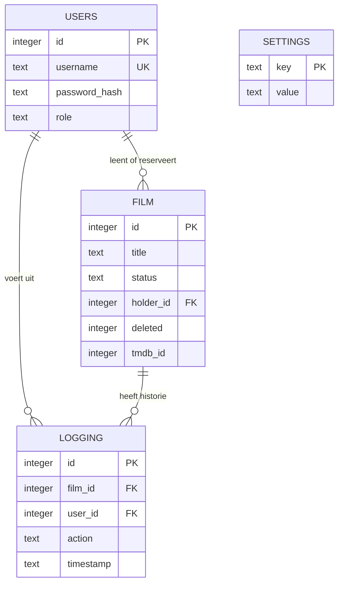

# Technische uitleg AlfaFlix

## Hoe de onderdelen samenwerken

Flask verwerkt de URL's in `app.py`. Jinja maakt de HTML-pagina's uit `templates/`. Alle pagina's erven van `base.html`, met gedeelde navigatie, stijl en meldingen. Bootstrap verzorgt onder andere kolommen, formulieren, knoppen en tabellen. Eigen CSS geeft de videotheek één consistente stijl.

Registreren, inloggen en uitloggen gebruiken normale HTML-formulieren. De collectie gebruikt JavaScript `fetch` om dezelfde API aan te spreken als Swagger. Toevoegen en verwijderen hebben uitsluitend API-endpoints. Het beheerpaneel is een browserinterface voor die endpoints. Read en Update zijn zowel via de website als rechtstreeks via de API bruikbaar.

`create_app()` maakt de app, configureert deze, registreert routes en initialiseert de database. Door de application factory kunnen de tests een eigen tijdelijke database gebruiken. `get_db()` opent één SQLite-verbinding per request. De teardown sluit de verbinding.

## Databasemodel

| Tabel | Belangrijkste velden | Doel |
|---|---|---|
| users | id, username, password_hash, role | Gebruikers en rechten |
| film | id, title, genre, year, description, poster_url, tmdb_id, status, holder_id, deleted | Eén fysiek DVD-exemplaar |
| logging | id, film_id, user_id, action, timestamp | Geschiedenis van geslaagde handelingen |
| settings | key, value | Eenmalig initialiseren van voorbeeldfilms |

Een gebruiker kan nul of meerdere DVD's lenen/reserveren. Een beschikbare DVD heeft geen eigenaar; een uitgeleende of gereserveerde DVD heeft precies één eigenaar. Een DVD en een gebruiker kunnen elk veel logregels hebben. SETTINGS staat los van de andere tabellen.

De `CHECK`-constraints in `schema.sql` beperken de toegestane rollen, statussen, acties en de combinatie status/eigenaar. Foreign keys zijn ingeschakeld. Een DVD verwijderen is een soft delete (`deleted=1`), zodat zijn logregels behouden blijven. De titel in de geschiedenis is de huidige titel van de gekoppelde DVD.

## Statusovergangen

| Beginstatus | Actie | Eindstatus | Uitvoerder |
|---|---|---|---|
| beschikbaar | lenen | uitgeleend | Ingelogde klant of beheerder; DVD komt op naam van de uitvoerder |
| uitgeleend | terugbrengen | beschikbaar | Lener of beheerder |
| beschikbaar | reserveren | gereserveerd | Ingelogde klant of beheerder; DVD komt op naam van de uitvoerder |
| gereserveerd | annuleren | beschikbaar | Reserveerder of beheerder |

Een gereserveerde DVD heeft geen directe overgang naar uitgeleend. De opdracht eist dat gereserveerde DVD's niet uitgeleend kunnen worden. Daarom moet eerst worden geannuleerd.

## Waarom een transactie?

Bij reserveren worden de filmstatus, eigenaar en logregel samen opgeslagen. `BEGIN IMMEDIATE` neemt vooraf het SQLite-schrijfslot. Als twee klanten dezelfde beschikbare DVD kiezen, kan één aanvraag de status wijzigen. De tweede leest na het wachten de nieuwe status en krijgt 409. Bij een fout wordt de hele transactie teruggedraaid. Hetzelfde principe geldt voor lenen, terugbrengen, annuleren en de controle bij verwijderen.

## Beveiliging

- Wachtwoorden worden met Werkzeug/scrypt gehasht, niet leesbaar opgeslagen.
- De gebruikersnaam is uniek zonder onderscheid tussen hoofdletters en kleine letters.
- SQL-waarden gaan via parameters. Dynamische kolomnamen worden beperkt door een vaste whitelist.
- Jinja escaped HTML. JavaScript escaped gegevens voor opname in HTML.
- Een ondertekende sessiecookie bewaart het gebruikers-ID. De rol wordt bij ieder request uit de database gelezen.
- Registratie accepteert geen adminrol. Alleen een lokale CLI-opdracht maakt een beheerder.
- Alle mutaties gebruiken CSRF-controle; login en registratie ook. Uitloggen gebruikt POST.
- Status en eigenaar kunnen niet via vrije PATCH-data worden aangepast. Daarvoor bestaan gecontroleerde actie-endpoints.
- De API toont geen klant-ID's van andere leners. Een gewone gebruiker ziet alleen de eigen logregels.
- De sessiesleutel staat in `.env` of een automatisch aangemaakt lokaal sleutelbestand. Beide worden niet ingecheckt.
- `.env` bevat het TMDB-token; het token wordt niet naar de browser gestuurd.
- De ontwikkelserver draait alleen op 127.0.0.1 en heeft debug uit.

Dit is een lokale onderwijsapp. 2FA, OAuth, rate-limiting, productiehosting en uitgebreide gebruikersadministratie vallen buiten de geïmplementeerde bonus. Er is geen migratiesysteem voor bestaande databases.

## TMDB-integratie

Een beheerder kiest per DVD **Filmgegevens ophalen**. De server vraagt `/3/movie/{tmdb_id}?language=nl-NL` op met een Bearer-token en een time-out van acht seconden. De omschrijving en het posterpad moeten beide aanwezig zijn. De app bouwt de poster-URL met `https://image.tmdb.org/t/p/w500`, en bewaart de URL en omschrijving. Er vindt geen externe aanvraag per paginabezoek plaats. Een mislukte aanvraag overschrijft geen bestaande data.

## Belangrijkste functies kunnen uitleggen

| Code | Uitleg in eenvoudige woorden |
|---|---|
| `load_user_and_check_csrf` | Haalt de ingelogde gebruiker op en controleert of een wijzigingsaanvraag een geldig token heeft. |
| `login_required` | Stopt bezoekers die niet ingelogd zijn. |
| `admin_required` | Stopt gewone gebruikers bij beheeracties. |
| `validate_film` | Controleert veldnamen, typen en lengtes voordat data naar SQL gaat. |
| `film_action` | Regelt de toegestane statusovergangen en schrijft de logregel. |
| `public_film` | Geeft de browser alleen toegestane filmgegevens plus of de DVD van de huidige gebruiker is. |
| `enrich_film` | Haalt omschrijving en poster op bij TMDB. |
| `loadFilms` in JavaScript | Haalt de collectie op en toont de beschikbare knoppen per status en rol. |

## Geraadpleegde documentatie

- Flask application factory: https://flask.palletsprojects.com/en/stable/tutorial/factory/
- Flask databaseverbinding: https://flask.palletsprojects.com/en/stable/tutorial/database/
- Flask testen: https://flask.palletsprojects.com/en/stable/testing/
- TMDB Bearer-authenticatie: https://developer.themoviedb.org/docs/authentication-application
- TMDB afbeeldingen: https://developer.themoviedb.org/docs/image-basics
